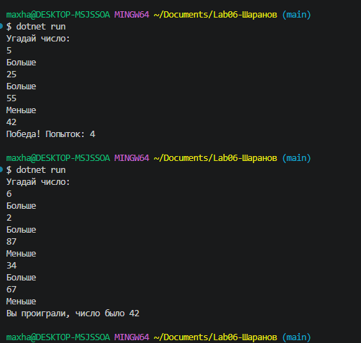
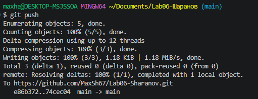

# Практическая работа №6. Циклы
ФИО: Шаранов Максим
Группа: 242
Дата: 21.11.2026

## Что изучено
- Для цикла `for` нужно знать, сколько раз его повторять, а для `while` нет.
- `do while` сначала делает, а потом проверяет, поэтому точно выполнится хотя бы раз.
- `break` выкидывает из цикла, а `continue` пропускает шаг и идет дальше.

## Скриншоты

